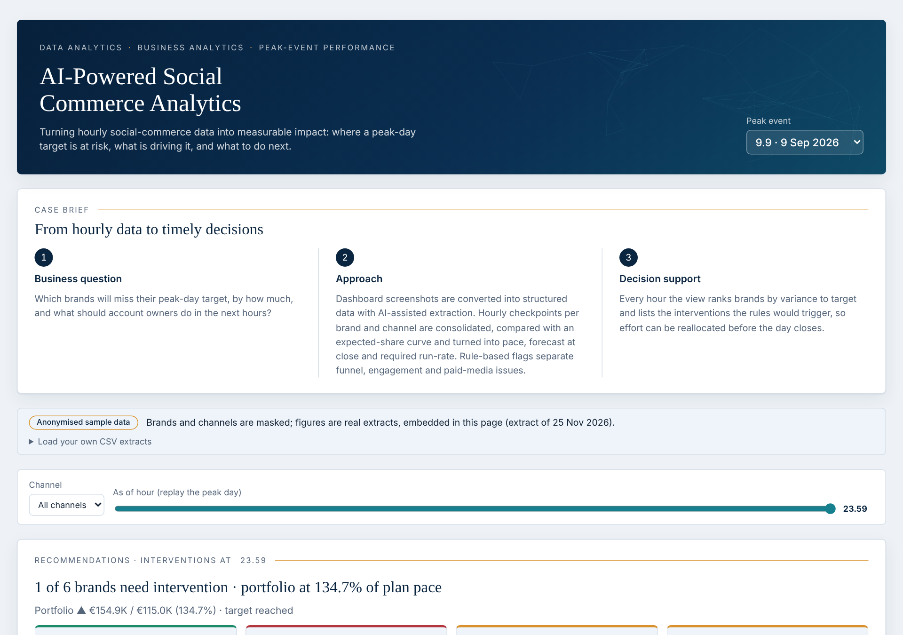
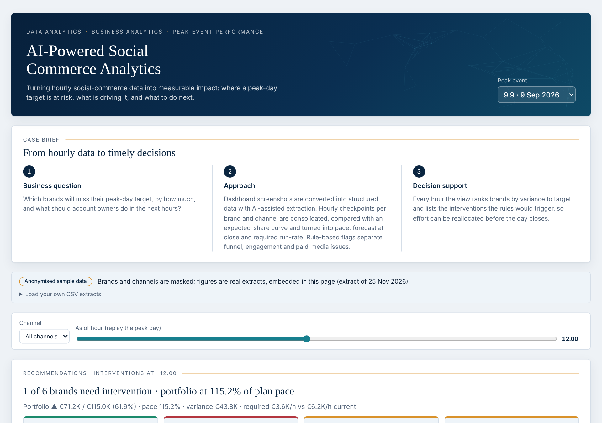
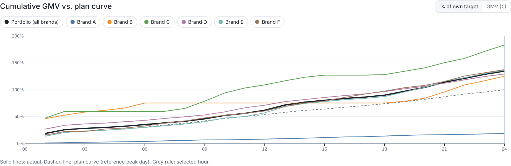
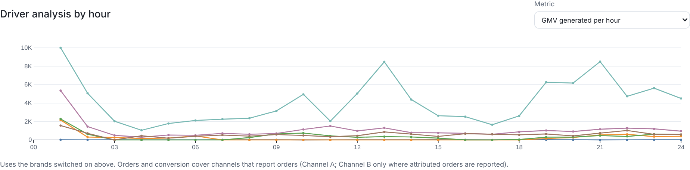
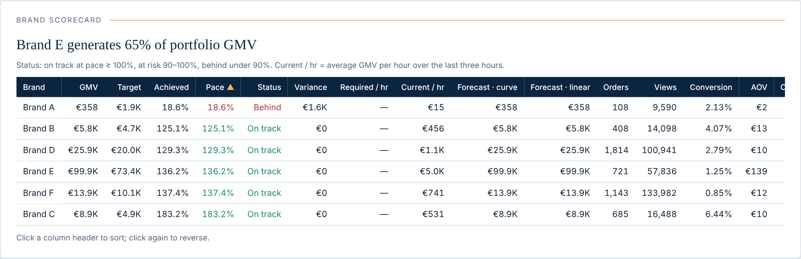
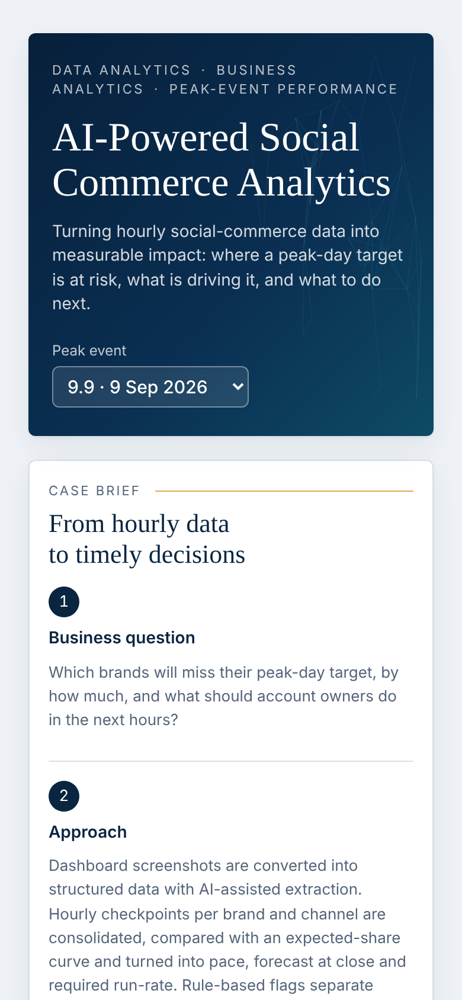

# Claude-Powered Real-Time Business Data Analytics Dashboard

An interactive control-tower dashboard that tracks hourly revenue (GMV) against plan during a one-day sales peak, forecasts where each brand will close, and turns variances into rule-based interventions.

**Live demo:** https://diegacv.github.io/AI-Powered-Data-Analytics-Dashboard/ (interactive: pick the peak event, filter by channel, replay the day hour by hour).

## Screenshots

**Overview at the end of the peak day.** Interventions, portfolio KPIs and the case brief.



**Replaying the day at 12.00.** The same view mid-day, when interventions were still possible.



**Cumulative GMV against the plan curve.**



**Driver analysis by hour.**



**Brand scorecard.**



**Mobile view.**



To run it locally instead, download `index.html` and open it in any browser. No installation is needed.

> Revenue is shown in euros (converted from the original currency at a fixed 1 EUR = 20,140 IDR). All brand and channel names are masked (Brand A–F, Channel A and B). The figures are real extracts from a live campaign, kept for realism. No client, company or platform identifiers remain in the data or code.

## The business question

During a peak sales day, account owners have a few hours to correct course. Reporting was manual and arrived too late. The question this tool answers each hour:

1. Which brands will miss their target, and by how much?
2. What run-rate is required for the rest of the day compared with the current one?
3. Is the shortfall coming from traffic, conversion, basket size, engagement or paid media?

## Approach

| Step | What it does |
|---|---|
| 1. Consolidate | Hourly checkpoints from two channels are cleaned into one structure, including a rule for sessions that cross midnight. |
| 2. Aggregate | Cumulative totals per brand and hour, adding up every livestream session that ran that day. |
| 3. Benchmark | Actuals are compared with a plan curve (expected cumulative share of the day's GMV by hour). |
| 4. Forecast | Forecast at close by curve and by linear run-rate; required versus current hourly run-rate. |
| 5. Escalate | Threshold rules classify each brand (on track, at risk, behind) and flag funnel, engagement and paid-media deviations. |
| 6. Assure | A data-quality section lists missing checkpoints, offline hours and flagged records, so the numbers can be trusted or challenged. |

Full definitions are in [docs/methodology.md](docs/methodology.md).

## What the sample campaign shows

- The portfolio closed at **134.7% of target** (€154.9K against €115.0K); five of six brands finished above plan.
- **Brand A ended at 18.6% of target** and was flagged behind plan in the late-day reviews, so a lagging brand stays visible even when the portfolio total looks healthy.
- **Concentration risk:** Brand E generated about 64% of portfolio GMV, so portfolio pace mostly reflects one brand.
- Conversion varies widely across brands (from about 0.85% to 6.44%), which the all-brand benchmark rules surface as funnel flags.

Use the hour slider to replay the day and see how the interventions evolve.

## Features

- Peak event and channel selectors, plus an "as of hour" replay slider
- Intervention panel: on track, behind or at risk, paid media, funnel and engagement flags
- KPI cards: portfolio GMV, share of target, pace, variance, forecast at close, orders and conversion
- Cumulative GMV versus plan curve, and a driver chart with eleven selectable metrics
- Sortable brand scorecard (22 columns) and an hour-by-hour intervention log
- Data-quality section; light and dark themes; works at phone width
- Optional upload of your own CSV extracts (see `data/`)

## Python analysis

The same calculation chain is implemented in Python, so the logic can be read, tested and reused outside the dashboard.

- [`python/peak_event_analysis.ipynb`](python/peak_event_analysis.ipynb): the analysis as a story, with an executive summary, charts, interventions and a reconciliation against the dashboard (open it on GitHub, outputs are included)
- [`python/pipeline.py`](python/pipeline.py): the pandas pipeline (snapshots, hourly aggregation, pace and forecasts, escalation rules)
- [`python/output/`](python/output): exported results as CSV and JSON

The Python results are identical to the dashboard's: all 144 brand-hour rows and all 366 intervention messages were compared.

To run it yourself: `pip install -r python/requirements.txt`, then `python python/pipeline.py`, or open the notebook in Jupyter.

## Repository

```
index.html            Single-file dashboard (HTML, CSS, JavaScript, d3 v7 from a CDN)
data/                 Sample input tables as CSV (anonymised, EUR)
python/               Pandas pipeline, analysis notebook, exported results
screenshots/          Images used in this README
docs/methodology.md   Metric definitions, rules, data contract, limitations
```

## Skills demonstrated

Business-question framing, KPI and metric design, Python (pandas) analysis and reconciliation, forecasting against a reference curve, rule-based alerting, data cleaning and quality assurance, data visualisation, and communicating results to non-technical decision makers.

## Limitations

- The plan curve is one reference-day average applied to every brand; brand-specific curves would sharpen the pace signal.
- Conversion for Channel B is only available where attributed orders are reported.
- Results depend on the accuracy of the extracted checkpoints; flagged records are shown, not corrected.
